[**Portfolio**](https://www.marcocampo.com) &nbsp;·&nbsp; [LinkedIn](https://linkedin.com/in/marcxxv) &nbsp;·&nbsp; [Hugging Face](https://huggingface.co/marcxxv) &nbsp;·&nbsp; [X](https://x.com/marcxxv_) &nbsp;·&nbsp; [ORCID](https://orcid.org/0009-0003-8577-6923) &nbsp;·&nbsp; [Credly](https://www.credly.com/users/marc-nino-christopher-ocampo)

**Projects:** [Valley O'Ville AI Agent](https://www.marcocampo.com/projects/valley-oville-operations-bot) · [Sappy](https://sapinsapin.ai) · [BetterCalatagan](https://bettercalatagan.vercel.app) · [TrabahoLens](https://trabaho-lens.vercel.app) · [Research Archive](https://research-archive-red.vercel.app) · [Valley O'Ville](https://valleyoville.com) · [Clipper](https://github.com/marcxxv/clipper) · [PisoLens](https://piso-lens.vercel.app) · [Public APIs](https://public-apis-tau.vercel.app/) · [AWS CLF-C02 Reviewer](https://aws-reviewer-clf-c02.vercel.app)

**Essays:** [The Lock Was Set to 004](https://www.marcocampo.com/blog/the-lock-was-set-to-004) · [Open Models](https://www.marcocampo.com/blog/you-dont-have-to-pay-to-start-with-open-models) · [What I Believe About AI](https://www.marcocampo.com/blog/what-i-believe-about-ai) · [My First Agent](https://www.marcocampo.com/blog/i-built-my-first-agent-to-fix-our-broken-data) · [All essays](https://www.marcocampo.com/blog)

**Credentials:** [Credly](https://www.credly.com/users/marc-nino-christopher-ocampo)

