

[**Portfolio**](https://www.marcocampo.com) &nbsp;·&nbsp; [LinkedIn](https://linkedin.com/in/marcxxv) &nbsp;·&nbsp; [Hugging Face](https://huggingface.co/marcxxv) &nbsp;·&nbsp; [X](https://x.com/marcxxv_) &nbsp;·&nbsp; [ORCID](https://orcid.org/0009-0003-8577-6923) &nbsp;·&nbsp; [Credly](https://www.credly.com/users/marc-nino-christopher-ocampo)

 

> *I build applied AI systems that real people use every day, and I write about what works and what doesn't.*

My focus is useful, calm products: assistants that show their work, research tools that respect privacy, and public data that can be traced to its source.

 

- **Valley O'Ville Family Resort**, since Apr 2026: General Manager, and builder of the resort's AI operations agent on [Hermes](https://github.com/NousResearch/hermes-agent). It runs around the clock on Oracle Cloud.
- **SapinSapin AI**, since Aug 2026 (volunteer): creator of **Sappy**, the assistant for an open-source initiative building speech and language data for Philippine languages, and designer of parts of [sapinsapin.ai](https://sapinsapin.ai).
- **BetterCalatagan**, since Oct 2026: creator and lead maintainer of an independent civic-information portal.

 

<a href="https://www.marcocampo.com/projects/valley-oville-operations-bot">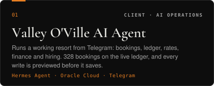</a> <a href="https://sapinsapin.ai">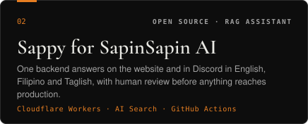</a>

<a href="https://bettercalatagan.vercel.app">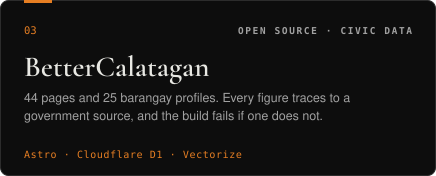</a> <a href="https://trabaho-lens.vercel.app">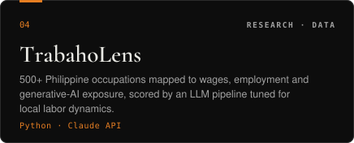</a>

<a href="https://research-archive-red.vercel.app">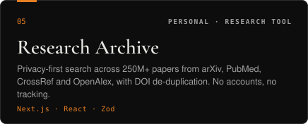</a> <a href="https://valleyoville.com">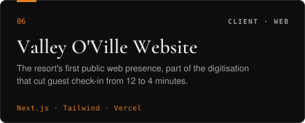</a>

 

| | |
|---|---|
| **[Clipper](https://github.com/marcxxv/clipper)** | Turns long videos into ranked, captioned vertical shorts. Runs locally; AI cost is about 1–2 US cents per video. |
| **[PisoLens](https://piso-lens.vercel.app)** | Philippine inflation tracker with 6 free tools for purchasing power, salary erosion and savings. Calculations stay in the browser. |
| **Condo Management System** | Multi-tenant platform for a Telectronic Systems client, built during my 486-hour internship: back office plus a mobile-first resident portal. |
| **[Public APIs Registry](https://public-apis-tau.vercel.app/)** | Open-source directory of 60+ free APIs with a browser testing playground. |
| **[AWS CLF-C02 Reviewer](https://aws-reviewer-clf-c02.vercel.app)** | 400+ practice questions with explanations, multiplayer sessions and live leaderboards. |

More case studies at **[marcocampo.com](https://www.marcocampo.com)**.

 

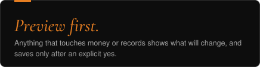 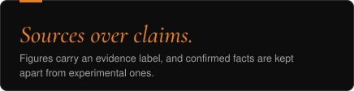

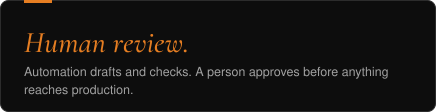 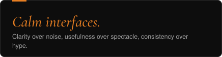

 

  

`Claude API` · `RAG` · `Hermes Agent` · `n8n` · `Oracle Cloud` · `Google Apps Script`

 

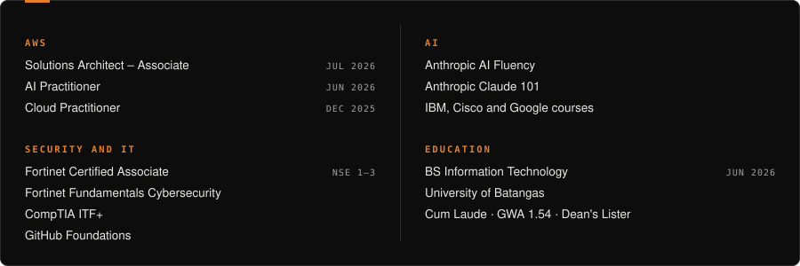

 

**Cybersecurity** · Oct 26, 2026
[The Lock Was Set to 004](https://www.marcocampo.com/blog/the-lock-was-set-to-004)

**Artificial Intelligence** · Oct 21, 2026
[You Don't Have to Pay to Start, Because Open Models Are Better Than You Think](https://www.marcocampo.com/blog/you-dont-have-to-pay-to-start-with-open-models)

**Artificial Intelligence** · Oct 18, 2026
[What I Believe About AI](https://www.marcocampo.com/blog/what-i-believe-about-ai)

**Artificial Intelligence** · Oct 2, 2026
[I Built My First Agent to Fix Our Broken Data](https://www.marcocampo.com/blog/i-built-my-first-agent-to-fix-our-broken-data)

All essays: **[marcocampo.com/blog](https://www.marcocampo.com/blog)**

 

*"The unexamined life is not worth living." — Socrates*

