

[**Portfolio**](https://www.marcocampo.com) &nbsp;·&nbsp; [LinkedIn](https://linkedin.com/in/marcxxv) &nbsp;·&nbsp; [Hugging Face](https://huggingface.co/marcxxv) &nbsp;·&nbsp; [X](https://x.com/marcxxv_) &nbsp;·&nbsp; [ORCID](https://orcid.org/0009-0003-8577-6923) &nbsp;·&nbsp; [Credly](https://www.credly.com/users/marc-nino-christopher-ocampo)

<a href="https://www.marcocampo.com"></a>
<a href="https://www.marcocampo.com"></a>

<a href="https://www.marcocampo.com/projects/valley-oville-operations-bot"></a>
<a href="https://www.marcocampo.com/projects/sapinsapin-ai"></a>
<a href="https://www.marcocampo.com/projects/better-calatagan"></a>
<a href="https://www.marcocampo.com/projects/trabaho-lens"></a>
<a href="https://www.marcocampo.com/projects/research-archive"></a>
<a href="https://www.marcocampo.com/projects/valley-oville-website"></a>

<a href="https://www.marcocampo.com/projects/clipper"></a>

<a href="https://www.marcocampo.com/projects/public-apis"></a>
<a href="https://www.marcocampo.com/projects/aws-clf-c02-reviewer"></a>
<a href="https://www.marcocampo.com"></a>
<a href="https://www.marcocampo.com"></a>
<a href="https://www.credly.com/users/marc-nino-christopher-ocampo"></a>

<a href="https://www.marcocampo.com/blog/you-dont-have-to-pay-to-start-with-open-models"></a>

<a href="https://www.marcocampo.com/blog/i-built-my-first-agent-to-fix-our-broken-data"></a>

[**Portfolio**](https://www.marcocampo.com) &nbsp;·&nbsp; [LinkedIn](https://linkedin.com/in/marcxxv) &nbsp;·&nbsp; [Hugging Face](https://huggingface.co/marcxxv) &nbsp;·&nbsp; [X](https://x.com/marcxxv_) &nbsp;·&nbsp; [ORCID](https://orcid.org/0009-0003-8577-6923) &nbsp;·&nbsp; [Credly](https://www.credly.com/users/marc-nino-christopher-ocampo)

