

<a href="https://www.marcocampo.com#gh-dark-mode-only"><picture><source media="(max-width: 640px)" srcset="assets/dm00.svg"></picture></a><a href="https://www.marcocampo.com#gh-light-mode-only"><picture><source media="(max-width: 640px)" srcset="assets/lm00.svg"></picture></a>
<a href="https://www.marcocampo.com#gh-dark-mode-only"><picture><source media="(max-width: 640px)" srcset="assets/dm01.svg"></picture></a><a href="https://www.marcocampo.com#gh-light-mode-only"><picture><source media="(max-width: 640px)" srcset="assets/lm01.svg"></picture></a>
<a href="https://www.marcocampo.com/projects#gh-dark-mode-only"><picture><source media="(max-width: 640px)" srcset="assets/dm02.svg"></picture></a><a href="https://www.marcocampo.com/projects#gh-light-mode-only"><picture><source media="(max-width: 640px)" srcset="assets/lm02.svg"></picture></a>
<a href="https://www.marcocampo.com/projects/valley-oville-operations-bot#gh-dark-mode-only"><picture><source media="(max-width: 640px)" srcset="assets/dm03.svg"></picture></a><a href="https://www.marcocampo.com/projects/valley-oville-operations-bot#gh-light-mode-only"><picture><source media="(max-width: 640px)" srcset="assets/lm03.svg"></picture></a>
<a href="https://www.marcocampo.com/projects/sapinsapin-ai#gh-dark-mode-only"><picture><source media="(max-width: 640px)" srcset="assets/dm04.svg"></picture></a><a href="https://www.marcocampo.com/projects/sapinsapin-ai#gh-light-mode-only"><picture><source media="(max-width: 640px)" srcset="assets/lm04.svg"></picture></a>
<a href="https://www.marcocampo.com/projects/better-calatagan#gh-dark-mode-only"><picture><source media="(max-width: 640px)" srcset="assets/dm05.svg"></picture></a><a href="https://www.marcocampo.com/projects/better-calatagan#gh-light-mode-only"><picture><source media="(max-width: 640px)" srcset="assets/lm05.svg"></picture></a>
<a href="https://www.marcocampo.com/projects/trabaho-lens#gh-dark-mode-only"><picture><source media="(max-width: 640px)" srcset="assets/dm06.svg"></picture></a><a href="https://www.marcocampo.com/projects/trabaho-lens#gh-light-mode-only"><picture><source media="(max-width: 640px)" srcset="assets/lm06.svg"></picture></a>
<a href="https://www.marcocampo.com/projects/research-archive#gh-dark-mode-only"><picture><source media="(max-width: 640px)" srcset="assets/dm07.svg"></picture></a><a href="https://www.marcocampo.com/projects/research-archive#gh-light-mode-only"><picture><source media="(max-width: 640px)" srcset="assets/lm07.svg"></picture></a>
<a href="https://www.marcocampo.com/projects/valley-oville-website#gh-dark-mode-only"><picture><source media="(max-width: 640px)" srcset="assets/dm08.svg"></picture></a><a href="https://www.marcocampo.com/projects/valley-oville-website#gh-light-mode-only"><picture><source media="(max-width: 640px)" srcset="assets/lm08.svg"></picture></a>
<a href="https://www.marcocampo.com/projects#gh-dark-mode-only"><picture><source media="(max-width: 640px)" srcset="assets/dm09.svg"></picture></a><a href="https://www.marcocampo.com/projects#gh-light-mode-only"><picture><source media="(max-width: 640px)" srcset="assets/lm09.svg"></picture></a>
<a href="https://www.marcocampo.com/projects/clipper#gh-dark-mode-only"><picture><source media="(max-width: 640px)" srcset="assets/dm10.svg"></picture></a><a href="https://www.marcocampo.com/projects/clipper#gh-light-mode-only"><picture><source media="(max-width: 640px)" srcset="assets/lm10.svg"></picture></a>
<a href="https://www.marcocampo.com/projects/pisolens#gh-dark-mode-only"><picture><source media="(max-width: 640px)" srcset="assets/dm11.svg"></picture></a><a href="https://www.marcocampo.com/projects/pisolens#gh-light-mode-only"><picture><source media="(max-width: 640px)" srcset="assets/lm11.svg"></picture></a>
<a href="https://www.marcocampo.com/projects/condo-management-system#gh-dark-mode-only"><picture><source media="(max-width: 640px)" srcset="assets/dm12.svg"></picture></a><a href="https://www.marcocampo.com/projects/condo-management-system#gh-light-mode-only"><picture><source media="(max-width: 640px)" srcset="assets/lm12.svg"></picture></a>
<a href="https://www.marcocampo.com/projects/public-apis#gh-dark-mode-only"><picture><source media="(max-width: 640px)" srcset="assets/dm13.svg"></picture></a><a href="https://www.marcocampo.com/projects/public-apis#gh-light-mode-only"><picture><source media="(max-width: 640px)" srcset="assets/lm13.svg"></picture></a>
<a href="https://www.marcocampo.com/projects/aws-clf-c02-reviewer#gh-dark-mode-only"><picture><source media="(max-width: 640px)" srcset="assets/dm14.svg"></picture></a><a href="https://www.marcocampo.com/projects/aws-clf-c02-reviewer#gh-light-mode-only"><picture><source media="(max-width: 640px)" srcset="assets/lm14.svg"></picture></a>
<a href="https://www.credly.com/users/marc-nino-christopher-ocampo#gh-dark-mode-only"><picture><source media="(max-width: 640px)" srcset="assets/dm15.svg"></picture></a><a href="https://www.credly.com/users/marc-nino-christopher-ocampo#gh-light-mode-only"><picture><source media="(max-width: 640px)" srcset="assets/lm15.svg"></picture></a>
<a href="https://www.marcocampo.com/blog#gh-dark-mode-only"><picture><source media="(max-width: 640px)" srcset="assets/dm16.svg"></picture></a><a href="https://www.marcocampo.com/blog#gh-light-mode-only"><picture><source media="(max-width: 640px)" srcset="assets/lm16.svg"></picture></a>
<a href="https://www.marcocampo.com/blog/the-lock-was-set-to-004#gh-dark-mode-only"><picture><source media="(max-width: 640px)" srcset="assets/dm17.svg"></picture></a><a href="https://www.marcocampo.com/blog/the-lock-was-set-to-004#gh-light-mode-only"><picture><source media="(max-width: 640px)" srcset="assets/lm17.svg"></picture></a>
<a href="https://www.marcocampo.com/blog/you-dont-have-to-pay-to-start-with-open-models#gh-dark-mode-only"><picture><source media="(max-width: 640px)" srcset="assets/dm18.svg"></picture></a><a href="https://www.marcocampo.com/blog/you-dont-have-to-pay-to-start-with-open-models#gh-light-mode-only"><picture><source media="(max-width: 640px)" srcset="assets/lm18.svg"></picture></a>
<a href="https://www.marcocampo.com/blog/what-i-believe-about-ai#gh-dark-mode-only"><picture><source media="(max-width: 640px)" srcset="assets/dm19.svg"></picture></a><a href="https://www.marcocampo.com/blog/what-i-believe-about-ai#gh-light-mode-only"><picture><source media="(max-width: 640px)" srcset="assets/lm19.svg"></picture></a>
<a href="https://www.marcocampo.com/blog/i-built-my-first-agent-to-fix-our-broken-data#gh-dark-mode-only"><picture><source media="(max-width: 640px)" srcset="assets/dm20.svg"></picture></a><a href="https://www.marcocampo.com/blog/i-built-my-first-agent-to-fix-our-broken-data#gh-light-mode-only"><picture><source media="(max-width: 640px)" srcset="assets/lm20.svg"></picture></a>
<a href="https://www.marcocampo.com#gh-dark-mode-only"><picture><source media="(max-width: 640px)" srcset="assets/dm21.svg"></picture></a><a href="https://www.marcocampo.com#gh-light-mode-only"><picture><source media="(max-width: 640px)" srcset="assets/lm21.svg"></picture></a>

[**Portfolio**](https://www.marcocampo.com) &nbsp;·&nbsp; [LinkedIn](https://linkedin.com/in/marcxxv) &nbsp;·&nbsp; [Hugging Face](https://huggingface.co/marcxxv) &nbsp;·&nbsp; [X](https://x.com/marcxxv_) &nbsp;·&nbsp; [ORCID](https://orcid.org/0009-0003-8577-6923) &nbsp;·&nbsp; [Credly](https://www.credly.com/users/marc-nino-christopher-ocampo)

Text version

**Marc Ocampo** — AI Engineer and Researcher. General Manager and AI Systems Engineer at Valley O'Ville Family Resort. BS Information Technology (Cum Laude), AWS Certified Solutions Architect – Associate.

I build applied AI systems that real people use every day, and I write about what works and what doesn't. My focus is useful, calm products: assistants that show their work, research tools that respect privacy, and public data that can be traced to its source.

**Selected work**
- [Valley O'Ville AI Agent](https://www.marcocampo.com/projects/valley-oville-operations-bot): Runs a working resort from Telegram: bookings, ledger, rates, finance and hiring. 328 live bookings, and every write is previewed before it saves.
- [Sappy for SapinSapin AI](https://www.marcocampo.com/projects/sapinsapin-ai): One backend answers on the website and in Discord in English, Filipino and Taglish, with human review before anything reaches production.
- [BetterCalatagan](https://www.marcocampo.com/projects/better-calatagan): 44 pages and 25 barangay profiles. Every figure traces to a government source, and the build fails if one does not.
- [TrabahoLens](https://www.marcocampo.com/projects/trabaho-lens): 500+ Philippine occupations mapped to wages, employment and generative-AI exposure, scored by an LLM pipeline tuned for local labor dynamics.
- [Research Archive](https://www.marcocampo.com/projects/research-archive): Privacy-first search across 250M+ papers from arXiv, PubMed, CrossRef and OpenAlex, with DOI de-duplication. No accounts, no tracking.
- [Valley O'Ville Website](https://www.marcocampo.com/projects/valley-oville-website): The resort's first public web presence, part of the digitisation that cut guest check-in from 12 to 4 minutes.

**Also built**
- [Clipper](https://www.marcocampo.com/projects/clipper): Turns long videos into ranked, captioned vertical shorts. Runs locally; AI cost is about 1–2 US cents per video.
- [PisoLens](https://www.marcocampo.com/projects/pisolens): Philippine inflation tracker with 6 free tools for purchasing power, salary erosion and savings.
- [Condo Management System](https://www.marcocampo.com/projects/condo-management-system): Multi-tenant platform for a Telectronic Systems client, built during my 486-hour internship.
- [Public APIs Registry](https://www.marcocampo.com/projects/public-apis): Open-source directory of 60+ free APIs with a browser testing playground.
- [AWS CLF-C02 Reviewer](https://www.marcocampo.com/projects/aws-clf-c02-reviewer): 400+ practice questions with explanations, multiplayer sessions and live leaderboards.

**Stack**
- Languages and frameworks: Python · TypeScript · JavaScript · React · Next.js · Astro · Laravel
- Cloud and data: AWS · Cloudflare Workers · Oracle Cloud · PostgreSQL · Firebase · Vercel · GitHub Actions
- Ai and automation: Claude API · RAG · Hermes Agent · n8n · Google Apps Script

**Credentials**
- AWS: Solutions Architect – Associate (Jul 2026); AI Practitioner (Jun 2026); Cloud Practitioner (Dec 2025)
- Security and IT: Fortinet Cybersecurity (NSE 1–3); CompTIA ITF+; GitHub Foundations
- AI: Anthropic AI Fluency; Anthropic Claude 101; IBM, Cisco and Google courses

**Writing**
- [The Lock Was Set to 004](https://www.marcocampo.com/blog/the-lock-was-set-to-004) (Cybersecurity · Oct 26, 2026)
- [You Don't Have to Pay to Start, Because Open Models Are Better Than You Think](https://www.marcocampo.com/blog/you-dont-have-to-pay-to-start-with-open-models) (Artificial Intelligence · Oct 21, 2026)
- [What I Believe About AI](https://www.marcocampo.com/blog/what-i-believe-about-ai) (Artificial Intelligence · Oct 18, 2026)
- [I Built My First Agent to Fix Our Broken Data](https://www.marcocampo.com/blog/i-built-my-first-agent-to-fix-our-broken-data) (Artificial Intelligence · Oct 2, 2026)

