[**Portfolio**](https://www.marcocampo.com) &nbsp;·&nbsp; [LinkedIn](https://linkedin.com/in/marcxxv) &nbsp;·&nbsp; [Hugging Face](https://huggingface.co/marcxxv) &nbsp;·&nbsp; [X](https://x.com/marcxxv_) &nbsp;·&nbsp; [ORCID](https://orcid.org/0009-0003-8577-6923) &nbsp;·&nbsp; [Credly](https://www.credly.com/users/marc-nino-christopher-ocampo)

 

<picture>
  <source media="(prefers-color-scheme: dark)" srcset="assets/about-dark.svg">
  
</picture>

> *I build applied AI systems that real people use every day, and I write about what works and what doesn't.*

My focus is useful, calm products: assistants that show their work, research tools that respect privacy, and public data that can be traced to its source.

 

<picture>
  <source media="(prefers-color-scheme: dark)" srcset="assets/now-dark.svg">
  
</picture>

- **Valley O'Ville Family Resort** (Apr 2026 – present): General Manager and AI systems engineer. I run daily operations and built the resort's AI operations agent on [Hermes](https://github.com/NousResearch/hermes-agent), with 14 specialised skills, running around the clock on Oracle Cloud against a live ledger of 328 bookings. Every change is previewed and saved only after an explicit yes. Digitisation helped cut guest check-in from 12 to 4 minutes.
- **SapinSapin AI** (Aug 2026 – present, volunteer): I created **Sappy**, the retrieval-augmented assistant for this open-source initiative building speech and language datasets for Philippine languages. It answers on the website and in Discord in English, Filipino and Taglish. I also design and build parts of [sapinsapin.ai](https://sapinsapin.ai).
- **BetterCalatagan** (Oct 2026 – present): creator and lead maintainer of an independent civic portal for Calatagan, Batangas.

 

<picture>
  <source media="(prefers-color-scheme: dark)" srcset="assets/selected-work-dark.svg">
  
</picture>

Ranked by real-world impact: live use and users first, then public benefit, then research and tools.

| # | Project | What it does and why it matters | Stack |
|---|---|---|---|
| 1 | **[Valley O'Ville AI Operations Agent](https://www.marcocampo.com/projects/valley-oville-operations-bot)** | Runs a working resort from Telegram: bookings, ledger, rates, finance, guest replies, hiring and Facebook posting. 328 bookings on the live ledger, 50 logged corrections, 32 of 32 payment and 313 of 313 charge entries pass automated checks, 40 job applicants scored. Featured as a case study by NYO. | Hermes Agent, Oracle Cloud, Telegram, Google Apps Script, Python |
| 2 | **[Sappy · SapinSapin AI](https://sapinsapin.ai)** | Retrieval-augmented assistant for an open-source Philippine-language AI initiative. One backend answers on the website and in Discord in English, Filipino and Taglish, with 6 GitHub Actions workflows and human review before production. | Cloudflare Workers, AI Search, GitHub Actions |
| 3 | **[BetterCalatagan](https://bettercalatagan.vercel.app)** ([source](https://github.com/marcxxv/bettercalatagan)) | Independent civic portal: 44 pages and 25 barangay profiles. Every figure traces to a government source, and the build fails if one doesn't. | Astro, TypeScript, Cloudflare D1 and Vectorize |
| 4 | **[TrabahoLens](https://trabaho-lens.vercel.app)** ([source](https://github.com/marcxxv/TrabahoLens)) | Interactive map of 500+ Philippine occupations: wages, employment and generative-AI exposure, scored with an LLM pipeline tuned for OFW, informal-economy and platform effects. | Python, Claude API |
| 5 | **[Research Archive](https://research-archive-red.vercel.app)** ([source](https://github.com/marcxxv/research-archive)) | Privacy-first paper search across 250M+ papers from arXiv, PubMed, CrossRef and OpenAlex, with DOI de-duplication and citation export. No accounts, no tracking. | Next.js 16, React 19, Zod |
| 6 | **[Valley O'Ville Website](https://valleyoville.com)** | The resort's first public web presence, part of the digitisation that cut guest check-in from 12 to 4 minutes. | Next.js, Tailwind, Vercel |
| 7 | **Condo Management System** | Multi-tenant condo platform for a Telectronic Systems client: 21-table back office, mobile-first resident portal, six-role access. Built during my internship (486 hours). | AppSheet, Apps Script, React |
| 8 | **[Clipper](https://github.com/marcxxv/clipper)** | Open-source pipeline that turns long videos into ranked, captioned vertical shorts. Runs locally; AI cost is about 1–2 US cents per video. | Python, Whisper, OpenCV, ffmpeg |
| 9 | **[PisoLens](https://piso-lens.vercel.app)** | Philippine inflation tracker with 6 free tools for purchasing power, salary erosion and savings, using PSA CPI data. Calculations stay in the browser. | Next.js, React |
| 10 | **[Public APIs Registry](https://public-apis-tau.vercel.app/)** ([source](https://github.com/marcxxv/public-apis)) | Open-source directory of 60+ free APIs with a browser testing playground. | Next.js, Framer Motion |
| 11 | **[AWS CLF-C02 Reviewer](https://aws-reviewer-clf-c02.vercel.app)** | 400+ practice questions with explanations, multiplayer sessions and live leaderboards. | React, Firebase |

More case studies at **[marcocampo.com](https://www.marcocampo.com)**.

 

<picture>
  <source media="(prefers-color-scheme: dark)" srcset="assets/how-i-work-dark.svg">
  
</picture>

- **Preview first.** Anything that touches money or records shows what will change and saves only after an explicit yes.
- **Sources over claims.** Figures carry an evidence label, and confirmed facts are kept apart from experimental ones.
- **Human review before production.** Automation drafts and checks; a person approves.
- **Calm interfaces.** Clarity over noise, usefulness over spectacle, consistency over hype.

 

<picture>
  <source media="(prefers-color-scheme: dark)" srcset="assets/stack-dark.svg">
  
</picture>

  <picture>
    <source media="(prefers-color-scheme: dark)" srcset="https://skillicons.dev/icons?i=py%2Cts%2Cjs%2Creact%2Cnextjs%2Castro%2Claravel%2Cpostgres%2Ccloudflare%2Caws%2Cgithubactions%2Cvercel%2Cfirebase%2Cgit&perline=14&theme=dark">
    
  </picture>

`Claude API` · `RAG` · `Hermes Agent` · `n8n` · `Oracle Cloud` · `Google Apps Script`

 

<picture>
  <source media="(prefers-color-scheme: dark)" srcset="assets/credentials-dark.svg">
  
</picture>

- **AWS:** Solutions Architect – Associate (Jul 2026) · AI Practitioner (Jun 2026) · Cloud Practitioner (Dec 2025)
- **Security and IT:** Fortinet Certified Associate and Fundamentals Cybersecurity (NSE 1–3) · CompTIA ITF+ · GitHub Foundations
- **AI:** Anthropic AI Fluency and Claude 101, plus IBM, Cisco and Google courses
- **Education:** BS Information Technology, University of Batangas, graduated June 2026, Cum Laude, GWA 1.54, Dean's Lister
- Full list and verification on [Credly](https://www.credly.com/users/marc-nino-christopher-ocampo)

 

<picture>
  <source media="(prefers-color-scheme: dark)" srcset="assets/writing-dark.svg">
  
</picture>

I publish essays and technical notes on AI tools, security habits, building with open models, and lessons from shipping real systems. Read them at [marcocampo.com](https://www.marcocampo.com).

 

*"The unexamined life is not worth living." — Socrates*

